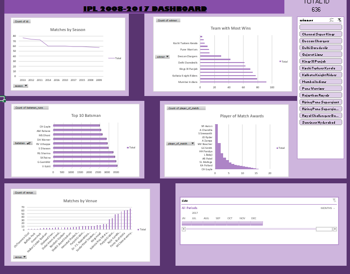

# IPL 2008–2017 Data Analysis & Dashboard

## 📊 Project Overview

This project presents an interactive IPL cricket data dashboard created using Microsoft Excel.

The dashboard analyzes IPL matches from 2008 to 2017 and provides insights into team performance, player performance, match venues, match seasons, and match awards.

## 🛠️ Tools Used

- Microsoft Excel
- Pivot Tables
- Pivot Charts
- Slicers
- Data Analysis
- Data Visualization

## 📈 Dashboard Features

### Matches by Season
Analyzes the number of IPL matches played across different seasons.

### Team with Most Wins
Compares the number of wins achieved by different IPL teams.

### Top 10 Batsmen
Identifies the top-performing batsmen based on runs.

### Player of the Match Awards
Analyzes players who received the most Player of the Match awards.

### Matches by Venue
Shows the distribution of IPL matches across different venues.

## 🎛️ Interactive Filters

The dashboard includes interactive filters for:

- Winner
- Player
- Season
- Date

## 💡 Key Insights

- The dashboard provides a comparison of team performance across IPL seasons.
- Top batsmen can be identified based on their total runs.
- Player of the Match awards provide an indication of individual match impact.
- Venue analysis shows where IPL matches were played most frequently.
- Season-wise analysis helps understand changes in the number of matches over time.

## 📷 Dashboard Preview

## 👩‍💻 Skills Demonstrated

- Microsoft Excel
- Data Analysis
- Data Visualization
- Pivot Tables
- Pivot Charts
- Interactive Dashboards
- Slicers
- KPI Analysis
- Business Insights
